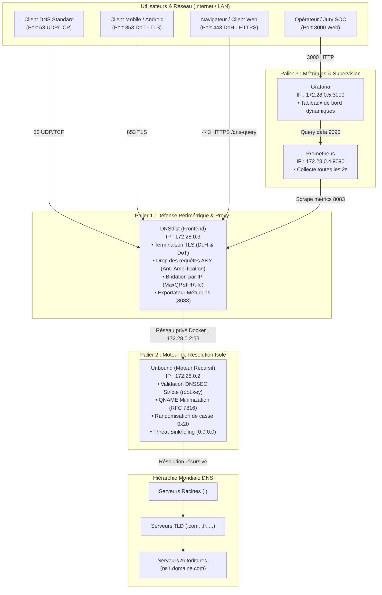

# Guide Complet de Déploiement et d'Exploitation : DNSaton
> **Projet Hackathon :** Déploiement et Sécurisation d'un Résolveur Public de DNS  
> **Composants :** Unbound (Récursif durci) + DNSdist (Passerelle DoH/DoT & Anti-DDoS) + Prometheus + Grafana  
> **Version :** 1.1.0 — Prêt pour la Production, Documentation Technique & Soutenance

---

## 1. Architecture et Matrice des Flux

DNSaton adopte une architecture dite **Two-Tier** (deux niveaux étanches) : le résolveur récursif n'est jamais exposé directement sur les réseaux publics. Il est protégé par une passerelle mandataire spécialisée.



### Matrice des Ports Réseau

| Service | Port Hôte | Protocole | Rôle |
| :--- | :--- | :--- | :--- |
| **DNSdist** | `53` | UDP & TCP | Résolution DNS publique conventionnelle |
| **DNSdist** | `853` | TCP | DNS-over-TLS (DoT - RFC 7858) |
| **DNSdist** | `443` | TCP | DNS-over-HTTPS (DoH - RFC 8484) |
| **DNSdist** | `8083` | TCP | Métriques brutes Prometheus & Console web |
| **Prometheus** | `9090` | TCP | Moteur de séries temporelles (TSDB) |
| **Grafana** | `3000` | TCP | Tableau de bord de supervision visuelle |

---

## 2. Prérequis Système

* **Système d'exploitation :** Linux x86_64 ou ARM64 (Ubuntu, Debian, Fedora, Arch, etc.).
* **Ressources minimales :** 1 CPU, 1 Go de RAM, 2 Go de stockage disque.
* **Paquets requis :**
  ```bash
  # Docker et Docker Compose
  docker --version          # >= 20.10
  docker compose version    # >= 2.0.0

  # Outils clients pour la recette et les tests
  which dig curl openssl python3
  ```

> [!IMPORTANT]
> **Conflit fréquent avec `systemd-resolved` :**  
> Sur Ubuntu/Debian, `systemd-resolved` écoute souvent par défaut sur le port local `127.0.0.53:53`.  
> Pour vérifier : `ss -tulpn | grep :53`.  
> Si le port 53 est occupé, libérez-le en désactivant le stub listener dans `/etc/systemd/resolved.conf` (`DNSStubListener=no`) puis `sudo systemctl restart systemd-resolved`.

---

## 3. Arborescence du Projet

```
/home/d4rkc4rl/hack/dnsaton/
├── docker-compose.yml              # Orchestrateur des 4 conteneurs et du réseau
├── README.md                       # Synthèse du projet et pitch de présentation
├── DEPLOYMENT_GUIDE.md             # Le présent guide exhaustif avec théorie
├── certs/
│   ├── server.key                  # Clé privée RSA 2048 bits
│   ├── server.crt                  # Certificat x509 auto-signé avec SANs
│   └── dnsdist-api.env             # Clé API générée pour l'accès aux métriques
├── unbound/
│   └── unbound.conf                # Configuration durcie du résolveur récursif
├── blocklists/
│   └── threats.conf                # Liste des domaines malveillants sinkholés
├── dnsdist/
│   └── dnsdist.conf                # Configuration frontend, DoH, DoT et Anti-DDoS
├── monitoring/
│   ├── prometheus/
│   │   └── prometheus.yml          # Intervalle de scrape et cible DNSdist
│   └── grafana/
│       ├── provisioning/
│       │   ├── datasources/
│       │   │   └── datasource.yml  # Auto-connexion à Prometheus
│       │   └── dashboards/
│       │       └── dashboards.yml  # Déclaration des dashboards de démarrage
│       └── dashboards/
│           └── dns-overview.json   # Définition du dashboard interactif
└── scripts/
    ├── generate-certs.sh           # Générateur automatisé de certificats TLS
    ├── test-suite.sh               # Suite de 8 tests de sécurité pour la démo
    └── traffic-generator.sh        # Générateur de trafic pour animer Grafana
```

---

## 4. Déploiement Étape par Étape

### Étape 1 : Création de la structure de répertoires
```bash
mkdir -p /home/d4rkc4rl/hack/dnsaton/{unbound,dnsdist,certs,blocklists,scripts}
mkdir -p /home/d4rkc4rl/hack/dnsaton/monitoring/{prometheus,grafana/provisioning/datasources,grafana/provisioning/dashboards,grafana/dashboards}
cd /home/d4rkc4rl/hack/dnsaton
```

---

### Étape 2 : Génération de la Cryptographie TLS (`scripts/generate-certs.sh`)
Les protocoles DoH et DoT exigent des clés cryptographiques et des certificats TLS conformes (incluant les extensions *Subject Alternative Name*).

```bash
cat << 'EOF' > scripts/generate-certs.sh
#!/usr/bin/env bash
set -euo pipefail

CERTS_DIR="$(cd "$(dirname "${BASH_SOURCE[0]}")/../certs" && pwd)"

echo "=== Génération du certificat TLS x509 avec SAN ==="
openssl req -x509 -nodes -days 365 -newkey rsa:2048 \
  -keyout "${CERTS_DIR}/server.key" \
  -out "${CERTS_DIR}/server.crt" \
  -subj "/CN=dnsaton.local/O=Hackathon DNS Resolver/C=FR" \
  -addext "subjectAltName=DNS:localhost,DNS:dnsaton.local,IP:127.0.0.1"

chmod 644 "${CERTS_DIR}/server.key"
chmod 644 "${CERTS_DIR}/server.crt"

echo "=== Génération de la clé API DNSdist ==="
API_KEY=$(openssl rand -hex 16)
echo "API_KEY=${API_KEY}" > "${CERTS_DIR}/dnsdist-api.env"
echo "Certificats prêts dans ${CERTS_DIR}"
EOF

chmod +x scripts/generate-certs.sh
./scripts/generate-certs.sh
```

---

### Étape 3 : Configuration du Moteur Récursif (`unbound/unbound.conf`)

```yaml
server:
    # --- Écoute réseau & Concurrence ---
    verbosity: 1
    interface: 0.0.0.0
    port: 53
    do-ip4: yes
    do-ip6: yes
    do-udp: yes
    do-tcp: yes
    num-threads: 2

    # --- Contrôle d'accès strict (Isolation interne) ---
    access-control: 0.0.0.0/0 refuse
    access-control: 127.0.0.0/8 allow
    access-control: 172.16.0.0/12 allow
    access-control: 192.168.0.0/16 allow

    # --- Intégrité & Authenticité : DNSSEC ---
    auto-trust-anchor-file: "/opt/unbound/etc/unbound/var/root.key"
    val-clean-additional: yes
    val-permissive-mode: no

    # --- Confidentialité (Privacy) ---
    qname-minimisation: yes
    hide-identity: yes
    hide-version: yes

    # --- Durcissement Anti-Empoisonnement de Cache ---
    use-caps-for-id: yes         # Encodage 0x20 bit (casse aléatoire)
    outgoing-range: 8192
    outgoing-num-tcp: 128
    incoming-num-tcp: 128

    # --- Protection Anti-Fragmentation IP (DNS Flag Day) ---
    edns-buffer-size: 1232
    max-udp-size: 1232

    # --- Optimisation du Cache ---
    msg-cache-size: 64m
    rrset-cache-size: 128m
    infra-cache-numhosts: 10000
    cache-min-ttl: 60
    cache-max-ttl: 86400
    prefetch: yes
    prefetch-key: yes

    # --- Threat Intelligence / Blocage de sécurité ---
    include: "/opt/unbound/etc/unbound/blocklists/*.conf"
```

---

### Étape 4 : Listes de Blocage des Cybermenaces (`blocklists/threats.conf`)

```apache
local-zone: "malware-test.evil.local" redirect
local-data: "malware-test.evil.local A 0.0.0.0"
local-data: "malware-test.evil.local AAAA ::"

local-zone: "phishing-bank.fake.local" redirect
local-data: "phishing-bank.fake.local A 0.0.0.0"
local-data: "phishing-bank.fake.local AAAA ::"

local-zone: "ransomware-c2.test" redirect
local-data: "ransomware-c2.test A 0.0.0.0"
local-data: "ransomware-c2.test AAAA ::"
```

---

### Étape 5 : Configuration de DNSdist (`dnsdist/dnsdist.conf`)

```lua
-- 1. Interfaces d'écoute
setLocal("0.0.0.0:53", { reusePort=true })
addTLSLocal("0.0.0.0:853", "/etc/dnsdist/certs/server.crt", "/etc/dnsdist/certs/server.key")
addDOHLocal("0.0.0.0:443", "/etc/dnsdist/certs/server.crt", "/etc/dnsdist/certs/server.key", {"/dns-query"}, { reusePort=true })

-- Autorisation des requêtes publiques (Internet et LAN)
addACL("0.0.0.0/0")
addACL("::/0")

-- 2. Console Web & Métriques Prometheus
webserver("0.0.0.0:8083")
setWebserverConfig({password="hackathon2026", apiKey="hackathon2026", statsRequireAuthentication=false, acl="0.0.0.0/0, ::/0"})

-- 3. Déclaration du Backend Récursif (Unbound)
newServer({
    address="172.28.0.2:53",
    name="unbound-backend",
    checkInterval=2,
    checkTimeout=1000,
    maxCheckFailures=3,
    mustResolve=false
})

-- 4. Protection Anti-DDoS & Règles de Sécurité
-- A. Blocage immédiat des requêtes de type ANY (Vecteur d'amplification)
addAction(QTypeRule(DNSQType.ANY), DropAction())

-- B. Bridation par IP source
addAction(MaxQPSIPRule(50, 32, 64), DelayAction(100)) -- Délai si > 50 req/s
addAction(MaxQPSIPRule(150, 32, 64), DropAction())    -- Rejet si > 150 req/s

-- C. Dynamic Blocking contre les floods
local dbr = dynBlockRulesGroup()
dbr:setQueryRate(100, 10, "Exceeded query rate limit", 60)
dbr:setRCodeRate(DNSRCode.SERVFAIL, 20, 10, "Exceeded SERVFAIL rate limit", 60)

function maintenance()
    dbr:apply()
end
```

---

### Étape 6 : Configuration du Monitoring (Prometheus + Grafana)

Fichiers placés dans `monitoring/` :
* `monitoring/prometheus/prometheus.yml` : scrape de `dnsdist:8083` toutes les 2s.
* `monitoring/grafana/provisioning/datasources/datasource.yml` : liaison automatique vers Prometheus (`http://prometheus:9090`).
* `monitoring/grafana/provisioning/dashboards/dashboards.yml` : déclaration du répertoire `/var/lib/grafana/dashboards`.
* `monitoring/grafana/dashboards/dns-overview.json` : le tableau de bord avec les panels QPS, DoH, DoT, Drops, Latence et statut UP.

---

### Étape 7 : Orchestration Docker Compose (`docker-compose.yml`)

```yaml
services:
  unbound:
    image: mvance/unbound:latest
    container_name: dnsaton-unbound
    restart: unless-stopped
    volumes:
      - ./unbound/unbound.conf:/opt/unbound/etc/unbound/unbound.conf:ro
      - ./blocklists:/opt/unbound/etc/unbound/blocklists:ro
    networks:
      dns_internal:
        ipv4_address: 172.28.0.2

  dnsdist:
    image: powerdns/dnsdist-19:latest
    container_name: dnsaton-dnsdist
    restart: unless-stopped
    ports:
      - "53:53/udp"
      - "53:53/tcp"
      - "853:853/tcp"
      - "443:443/tcp"
      - "8083:8083/tcp"
    volumes:
      - ./dnsdist/dnsdist.conf:/etc/dnsdist/dnsdist.conf:ro
      - ./certs:/etc/dnsdist/certs:ro
    depends_on:
      - unbound
    networks:
      dns_internal:
        ipv4_address: 172.28.0.3

  prometheus:
    image: prom/prometheus:latest
    container_name: dnsaton-prometheus
    restart: unless-stopped
    ports:
      - "9090:9090"
    volumes:
      - ./monitoring/prometheus/prometheus.yml:/etc/prometheus/prometheus.yml:ro
    depends_on:
      - dnsdist
    networks:
      dns_internal:
        ipv4_address: 172.28.0.4

  grafana:
    image: grafana/grafana:latest
    container_name: dnsaton-grafana
    restart: unless-stopped
    ports:
      - "3000:3000"
    environment:
      - GF_SECURITY_ADMIN_USER=admin
      - GF_SECURITY_ADMIN_PASSWORD=admin
      - GF_USERS_ALLOW_SIGN_UP=false
      - GF_AUTH_ANONYMOUS_ENABLED=true
      - GF_AUTH_ANONYMOUS_ORG_ROLE=Viewer
    volumes:
      - ./monitoring/grafana/provisioning/datasources:/etc/grafana/provisioning/datasources:ro
      - ./monitoring/grafana/provisioning/dashboards:/etc/grafana/provisioning/dashboards:ro
      - ./monitoring/grafana/dashboards:/var/lib/grafana/dashboards:ro
    depends_on:
      - prometheus
    networks:
      dns_internal:
        ipv4_address: 172.28.0.5

networks:
  dns_internal:
    name: dnsaton_dns_internal
    driver: bridge
    ipam:
      config:
        - subnet: 172.28.0.0/24
```

---

### Étape 8 : Lancement de l'Infrastructure
```bash
docker compose up -d
docker compose ps
```

---

## 5. Recette & Procédure de Validation (Démo Hackathon)

Exécutez le script automatisé de validation :
```bash
./scripts/test-suite.sh
```

### Détail des 8 vérifications effectuées par le script :

1. **Résolution standard (UDP 53) :** `dig @127.0.0.1 example.com +short` $\rightarrow$ Valide que l'adresse IP est correctement résolue.
2. **Authenticité cryptographique DNSSEC :** `dig @127.0.0.1 cloudflare.com +dnssec` $\rightarrow$ Valide la présence du flag `ad` (*Authenticated Data*).
3. **Rejet de signature corrompue :** `dig @127.0.0.1 dnssec-failed.org` $\rightarrow$ Valide que le résolveur renvoie `SERVFAIL` et bloque l'usurpation.
4. **Sinkholing de malware :** `dig @127.0.0.1 malware-test.evil.local` $\rightarrow$ Valide que le domaine est redirigé vers `0.0.0.0`.
5. **Défense Anti-Amplification :** `dig @127.0.0.1 cloudflare.com ANY` $\rightarrow$ Valide que la requête est silencieusement éliminée (`DropAction`).
6. **DNS-over-HTTPS (DoH) :** Requête HTTP/2 chiffrée sur le port 443 via format RFC 8484 (`/dns-query`).
7. **DNS-over-TLS (DoT) :** Négociation d'une session TLS native sur le port 853 et décodage de la réponse.
8. **Télémétrie Prometheus :** Vérification de l'exposition des métriques en direct sur le port 8083.

---

## 6. Démonstration Visuelle avec Grafana

1. Ouvrez votre navigateur sur :  
   **`http://localhost:3000/d/dnsaton-overview/dnsaton-supervision-securite-and-trafic`**  
   *(Ou depuis un autre appareil du réseau local : `http://192.168.1.132:3000`)*.
2. Dans un second terminal, démarrez le simulateur de trafic continu :
   ```bash
   ./scripts/traffic-generator.sh
   ```
3. Observez en temps réel les graphiques s'animer.

---

## 7. Commandes d'Exploitation Usuelles (Cheat Sheet)

```bash
# Consulter les logs en temps réel de la passerelle
docker compose logs -f dnsdist

# Consulter les logs du résolveur récursif
docker compose logs -f unbound

# Recharger la liste de blocage des malwares sans couper le service
docker compose exec unbound unbound-control reload

# Vérifier la santé des cibles Prometheus
curl -s http://localhost:9090/api/v1/targets | jq .

# Stopper complètement l'infrastructure
docker compose down

# Redémarrer l'infrastructure
docker compose up -d
```

---

## 8. Théorie & Explications Techniques Approfondies (Le Guide de Soutenance)

Cette section détaille le fonctionnement interne de chaque mécanisme de sécurité. C'est votre antisèche pour répondre aux questions pointues du jury.

### A. Pourquoi une architecture "Two-Tier" (DNSdist en front, Unbound en back) ?
* **Le danger d'un résolveur nu :** Un résolveur récursif comme Unbound dépense beaucoup de CPU et de mémoire par requête (parcours des racines, calculs cryptographiques RSA/ECDSA pour DNSSEC, gestion d'un arbre de cache complexe). S'il est directement exposé à Internet, une attaque par inondation (flood UDP) sature ses threads en quelques secondes.
* **Le rôle de DNSdist :** DNSdist est écrit en C++ haute performance avec du code réseau non-bloquant et multi-threadé (`SO_REUSEPORT`). Il est conçu pour traiter **plusieurs centaines de milliers de requêtes par seconde (QPS)**. Il joue le rôle de bouclier : il élimine le trafic malveillant, termine les sessions chiffrées lourdes (DoH et DoT), et ne transmet à Unbound que les requêtes légitimes et saines.

---

### B. Chiffrement du Transport : DoH (RFC 8484) et DoT (RFC 7858)
* **La vulnérabilité du DNS historique (Port 53) :** Les requêtes DNS transitent en texte clair. N'importe quel équipement sur le chemin réseau (votre FAI, l'administrateur du Wi-Fi public, un cybercriminel en ARP Spoofing) peut lire tous les sites consultés et même modifier la réponse à la volée.
* **DNS-over-TLS (DoT - Port 853) :** Établit un tunnel TLS directement autour du protocole DNS standard. Le trafic est chiffré de bout en bout entre le client et DNSdist. Utilisé nativement par Android ("DNS privé").
* **DNS-over-HTTPS (DoH - Port 443) :** Encapsule les messages DNS dans des requêtes HTTP/2 ou HTTP/3 via TLS. Avantage stratégique : le trafic DNS se fond complètement dans le trafic Web HTTPS classique sur le port 443. Il est donc impossible pour un pare-feu réseau de bloquer ou d'espionner le DNS sans casser tout le trafic Web.

---

### C. Intégrité et Authenticité : La Chaîne de Confiance DNSSEC
* **Le problème résolu :** Le chiffrement (DoH/DoT) sécurise uniquement le lien *Client $\leftrightarrow$ Résolveur*. Mais que se passe-t-il si un attaquant empoisonne la réponse entre le résolveur et le serveur autoritaire à l'autre bout du monde ? C'est le rôle de DNSSEC.
* **La chaîne cryptographique :**
  1. La **Racine mondiale (.)** signe la clé du TLD `.com` via un enregistrement `DS` (*Delegation Signer*).
  2. Le TLD `.com` signe la clé publique du domaine cible (ex. `cloudflare.com`).
  3. Le serveur de `cloudflare.com` signe ses enregistrements IP (`A`) avec sa clé privée, générant une signature numérique `RRSIG`.
* **Le rôle d'Unbound :** Unbound détient la clé racine mondiale (`root.key`). Quand il reçoit une réponse, il vérifie mathématiquement chaque signature en descendant l'arbre.
  * **Si valide :** Unbound certifie la réponse au client en activant le bit `ad` (*Authenticated Data*).
  * **Si invalide (clé altérée, fausse IP) :** Unbound rejette immédiatement la réponse et renvoie un statut `SERVFAIL` au client pour lui éviter d'être redirigé vers un faux site.

---

### D. Protection Anti-Amplification DDoS (Attaques par Réflexion UDP)
* **Mécanisme de l'attaque :** En UDP, l'adresse IP source n'est pas vérifiée (pas de poignée de main TCP). Un attaquant envoie une requête de 60 octets en usurpant l'IP d'une victime et en demandant un type `ANY` (qui demande tous les enregistrements du domaine d'un coup). Un résolveur mal configuré renvoie une réponse de 3 000 octets vers la victime. Le résolveur devient un amplificateur x50 pour attaquer une tierce personne.
* **La parade DNSdist :**
  1. `addAction(QTypeRule(DNSQType.ANY), DropAction())` : Toute requête demandant le type `ANY` est immédiatement détruite sans aucune réponse. L'attaquant ne peut rien amplifier.
  2. **Response Rate Limiting (RRL) :** Si une IP tente d'obtenir des réponses répétitives en rafale, DNSdist limite le taux de réponse.

---

### E. QNAME Minimization (RFC 7816) : Respect de la Vie Privée
* **Fonctionnement classique (bavard) :** Pour trouver `confidentiel.entreprise.example.com`, un résolveur classique envoie le nom complet aux serveurs racines mondiaux, puis aux serveurs `.com`. Les administrateurs de la racine voient donc passer vos sous-domaines intimes.
* **QNAME Minimization dans Unbound (`qname-minimisation: yes`) :**
  * À la racine `.`, Unbound demande uniquement : *"Qui gère le .com ?"*.
  * Au serveur TLD `.com`, il demande uniquement : *"Qui gère example.com ?"*.
  * Seul le serveur autoritaire final découvre le sous-domaine exact `confidentiel.entreprise`. Les métadonnées de navigation ne fuitent plus le long de la hiérarchie.

---

### F. Encodage 0x20 bit : Défense contre l'attaque de Kaminsky
* **L'attaque de Kaminsky :** Un pirate envoie des milliers de paquets UDP forgés avec de fausses IP en essayant de deviner le `Query ID` (16 bits, soit seulement 65 536 possibilités) pour injecter une fausse IP en cache avant la vraie réponse.
* **La parade 0x20 (`use-caps-for-id: yes`) :**
  * Dans la table ASCII, la différence entre majuscule et minuscule réside dans le 6ème bit (valeur hexadécimale `0x20`).
  * Unbound envoie le domaine avec une alternance pseudo-aléatoire de casse : `wWw.ExAmPlE.cOm`.
  * La RFC DNS impose aux serveurs autoritaires de recopier la question telle quelle dans la réponse.
  * Pour réussir son injection, le pirate doit désormais deviner le `Query ID` ET la combinaison exacte des majuscules/minuscules, multipliant la complexité mathématique par des millions.

---

### G. Threat Intelligence & Sinkholing Préventif
* **Principe :** Un résolveur moderne ne doit pas être un simple annuaire passif ; il doit protéger proactivement ses utilisateurs.
* **Fonctionnement :** En intégrant des listes de réputation de menaces (C2 de ransomwares, sites bancaires clonés pour phishing), Unbound intercepte la requête avant toute sortie réseau et renvoie `0.0.0.0`. L'ordinateur de l'utilisateur ne peut jamais établir la connexion TCP avec la machine du pirate.
